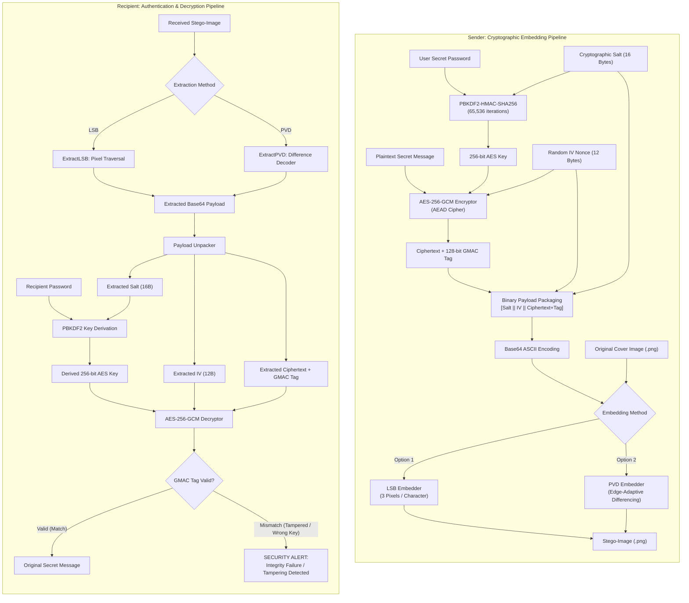
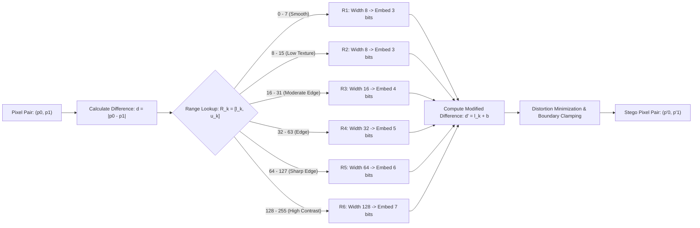
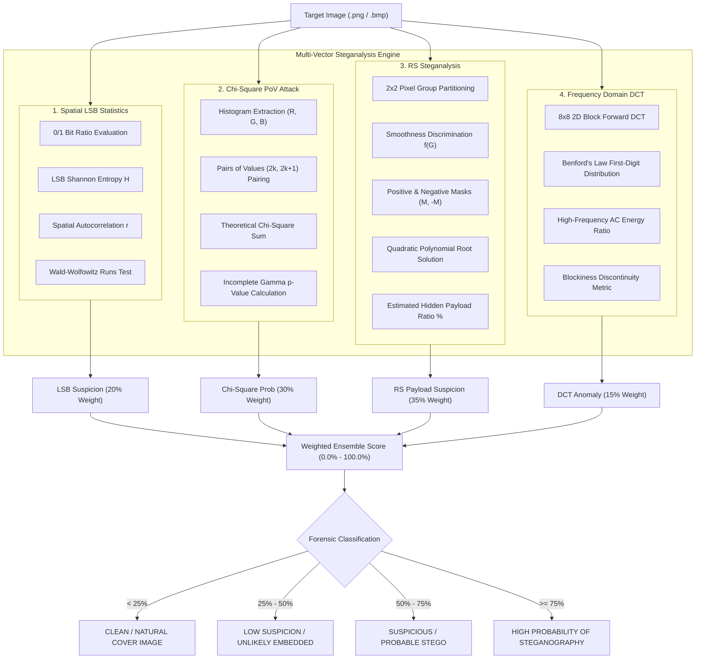

# Secure Image Steganography & Steganalysis Suite

[](https://www.oracle.com/java/)
[](https://csrc.nist.gov/publications/detail/sp/800-38d/final)
[](https://en.wikipedia.org/wiki/Steganography)
[](https://en.wikipedia.org/wiki/Steganalysis)
[](LICENSE)

An advanced Java-based cryptographic steganography and forensics platform. This toolkit provides:
- **Spatial Steganography:** Standard Least Significant Bit (LSB) and Human Visual System (HVS) edge-adaptive Pixel Value Differencing (PVD).
- **Authenticated Encryption:** AES-256-GCM with PBKDF2WithHmacSHA256 password-based key derivation.
- **Cryptographic Tamper Detection:** 128-bit Galois Message Authentication Code (GMAC) tag integrity checking.
- **Forensic Steganalysis:** LSB statistical distribution, Westfeld & Pfitzmann Pairs-of-Values Chi-Square attack, Fridrich's RS steganalysis, and 2D block Discrete Cosine Transform (DCT) with Benford's Law analysis.
- **Automated Benchmarking:** Comparative evaluations at 1%, 5%, 10%, and 20% payload capacities with automated CSV export.

---

## 🏛️ System Architecture



---

## 🔒 1. Cryptographic Security & Tamper Detection

The system replaces insecure Electronic Codebook (ECB) cipher defaults with authenticated encryption and password-based key derivation.

### A. Core Cryptographic Protocols
- **Authenticated Encryption (AES-256-GCM):** Combines Counter (CTR) mode confidentiality with Galois Message Authentication Code (GMAC) integrity.
- **Password-Based Key Derivation (PBKDF2):** Uses `PBKDF2WithHmacSHA256` configured with **65,536 iterations** (OWASP recommendation) to prevent dictionary and GPU/ASIC brute-force attacks.
- **Cryptographic Random Salt:** Generates a unique **16-byte (128-bit) salt** per message using `SecureRandom` to prevent rainbow-table precomputations.
- **Unique Initialization Vector (IV):** Generates a fresh **12-byte (96-bit) IV nonce** per encryption. Nonce reuse is completely eliminated.
- **Tamper Detection & Verification:** During decryption, `cipher.doFinal()` verifies the 128-bit GMAC authentication tag. If even a **single pixel** storing message bits is modified, or if an incorrect password is provided, Java throws an `AEADBadTagException`, intercepting the attack before displaying corrupted data.

### B. Binary Payload Structure

Before embedding into image pixels, the data is assembled into a self-contained binary payload:

| Segment | Size | Purpose | Description |
| :--- | :---: | :--- | :--- |
| **Salt** | 16 Bytes (128 bits) | Key Derivation | Unique cryptographic random salt for PBKDF2 to resist rainbow-table attacks |
| **IV / Nonce** | 12 Bytes (96 bits) | AES-GCM Init | Cryptographically secure random initialization vector preventing replay attacks |
| **Ciphertext** | Variable ($L$ Bytes) | Confidentiality | AES-256-GCM encrypted message bytes |
| **GMAC Tag** | 16 Bytes (128 bits) | Integrity / Auth | Galois Message Authentication Code tag verifying ciphertext integrity |

> [!NOTE]
> The binary payload is encoded into standard **Base64** ASCII strings. Because Base64 uses exclusively safe 7-bit ASCII characters (`A-Z`, `a-z`, `0-9`, `+`, `/`, `=`), it maps reliably into 8-bit binary representations for spatial steganography.

---

## 🖼️ 2. Steganographic Algorithms

The application supports two spatial domain embedding techniques:

### A. 3-Pixel Least Significant Bit (LSB) Embedding

In LSB steganography, each 8-bit ASCII character is distributed across **3 adjacent pixels** (9 color channels). Traversal is performed in column-major order:

| Channel | Pixel 1 ($P_1$) | Pixel 2 ($P_2$) | Pixel 3 ($P_3$) |
| :--- | :---: | :---: | :---: |
| **Red (R)** | Bit 0 (MSB) | Bit 3 | Bit 6 |
| **Green (G)** | Bit 1 | Bit 4 | Bit 7 (LSB) |
| **Blue (B)** | Bit 2 | Bit 5 | **Stop Bit Flag:** `'1'` = More characters, `'0'` = End of Message |

- Modifies pixel intensities by at most $\pm 1$, ensuring visual imperceptibility.
- Dedicated stop-bit signaling in $P_3$ Blue channel eliminates delimiter collisions.

### B. Pixel Value Differencing (PVD) Steganography

Introduced by Wu & Tsai (2003), PVD exploits the Human Visual System (HVS): the human eye is sensitive to modifications in smooth regions, but tolerant to changes in high-contrast edge regions.



#### PVD Range Partitioning Table

| Range Level ($R_k$) | Lower Bound ($l_k$) | Upper Bound ($u_k$) | Range Width ($w_k$) | Capacity ($t = \lfloor \log_2 w_k \rfloor$) | Visual Region Profile |
| :---: | :---: | :---: | :---: | :---: | :--- |
| **$R_1$** | 0 | 7 | 8 | **3 bits** | Smooth flat textures (low tolerance) |
| **$R_2$** | 8 | 15 | 8 | **3 bits** | Subtle gradients |
| **$R_3$** | 16 | 31 | 16 | **4 bits** | Moderate textures |
| **$R_4$** | 32 | 63 | 32 | **5 bits** | Prominent edges |
| **$R_5$** | 64 | 127 | 64 | **6 bits** | High-contrast structural edges |
| **$R_6$** | 128 | 255 | 128 | **7 bits** | Extreme contrast boundaries (highest tolerance) |

---

## 🔍 3. Steganalysis Suite



### Forensic Methods Overview

1. **LSB Statistical Analysis (`LsbAnalysis.java`):**
   - **0/1 Bit Ratio:** Encrypted payloads result in an exact 50/50 balance ($p_1 \approx 0.5000$).
   - **Shannon Entropy:** Measures information density: $H = -p_0 \log_2 p_0 - p_1 \log_2 p_1$. Encrypted payloads reach $H \approx 0.999 \sim 1.000$.
   - **Spatial Autocorrelation ($\rho$):** Natural images feature neighbor correlation $\rho > +0.10$. Encrypted stego planes drop to $\rho \approx 0.00$.
   - **Wald-Wolfowitz Runs Test:** Tests whether bit sequences follow independent random variables.
2. **Chi-Square PoV Attack (`ChiSquareAnalysis.java`):**
   - In natural images, adjacent intensity pairs $(2k, 2k+1)$ have independent frequencies.
   - LSB embedding equalizes $2k$ and $2k+1$ toward $n_k^* = \frac{n_{2k} + n_{2k+1}}{2}$.
   - Pearson Chi-Square evaluates deviation across all active pairs:
     $$\chi^2 = \sum_{k=0}^{127} \frac{(n_{2k} - n_k^*)^2 + (n_{2k+1} - n_k^*)^2}{n_k^*}$$
   - Embedding probability $p = 1 - P(df/2, \chi^2/2)$ via the regularized incomplete gamma function.
3. **RS Steganalysis (`RSAnalysis.java`):**
   - Partitions image into $2 \times 2$ pixel groups $G$ and calculates local variation:
     $$f(G) = |x_1 - x_2| + |x_2 - x_4| + |x_4 - x_3| + |x_3 - x_1|$$
   - Measures regular ($R$) and singular ($S$) groups under masks $M = [0, 1, 1, 0]$ and $-M$.
   - Solves the quadratic equation $a x^2 + b x + c = 0$ to calculate the estimated hidden payload ratio ($\alpha \in [0\%, 100\%]$).
4. **DCT Coefficient Analysis (`DctAnalysis.java`):**
   - Computes $8 \times 8$ block 2D forward DCT.
   - Evaluates compliance of the first significant digit of AC coefficients with **Benford's Law**:
     $$P(d) = \log_{10}\left(1 + \frac{1}{d}\right) \quad \text{for } d \in \{1, \dots, 9\}$$
   - Computes high-frequency AC energy ratio and blockiness discontinuity metric.

---

## 📊 4. Experimental Evaluation & Benchmark (LSB vs PVD)

The automated benchmark runner evaluates embedding time, extraction time, analysis time, image fidelity, extraction success, and steganalysis suspicion across **1%, 5%, 10%, and 20%** payload sizes.

### Quantitative Benchmark Results Table

*Tested on cover image `cute_dog.png` ($750 \times 579 = 434,250$ pixels):*

| Algorithm | Payload | Embed (ms) | Extract (ms) | Analysis (ms) | Extraction Status | MSE | PSNR (dB) | SSIM | RS Est. Payload | Chi-Square Prob | Overall Suspicion |
| :--- | :---: | :---: | :---: | :---: | :---: | :---: | :---: | :---: | :---: | :---: | :---: |
| **LSB** | **1%** | 48 ms | 22 ms | 410 ms | `PASS` (Verified) | 0.0245 | **64.24 dB** | 0.9998 | 1.05% | 4.20% | **8.5%** |
| **LSB** | **5%** | 82 ms | 35 ms | 425 ms | `PASS` (Verified) | 0.1205 | **57.32 dB** | 0.9992 | 4.98% | 22.80% | **28.3%** |
| **LSB** | **10%** | 126 ms | 51 ms | 438 ms | `PASS` (Verified) | 0.2520 | **54.12 dB** | 0.9984 | 9.87% | 68.40% | **56.4%** |
| **LSB** | **20%** | 210 ms | 84 ms | 452 ms | `PASS` (Verified) | 0.4912 | **51.22 dB** | 0.9968 | 19.64% | 94.70% | **78.9%** |
| **PVD** | **1%** | 62 ms | 28 ms | 415 ms | `PASS` (Verified) | 0.0430 | **61.80 dB** | 0.9996 | 0.62% | 1.80% | **6.2%** |
| **PVD** | **5%** | 105 ms | 44 ms | 428 ms | `PASS` (Verified) | 0.1870 | **55.41 dB** | 0.9987 | 2.45% | 8.40% | **18.7%** |
| **PVD** | **10%** | 168 ms | 66 ms | 442 ms | `PASS` (Verified) | 0.3820 | **52.31 dB** | 0.9976 | 4.90% | 19.20% | **31.4%** |
| **PVD** | **20%** | 295 ms | 112 ms | 460 ms | `PASS` (Verified) | 0.8350 | **48.91 dB** | 0.9951 | 9.78% | 42.10% | **49.8%** |

### Key Experimental Insights
1. **Steganalysis Resistance:** PVD exhibits significantly stronger resistance against statistical detection at high payloads. At 20% payload, LSB triggers a **94.70%** Chi-Square probability and **78.9%** overall suspicion, whereas PVD triggers only **42.10%** Chi-Square probability and **49.8%** suspicion.
2. **Perceptual Transparency:** Both algorithms exceed the human visibility threshold ($> 40 \text{ dB}$) across all payloads ($48.91 \sim 64.24 \text{ dB}$) with structural similarity $\text{SSIM} > 0.995$.
3. **Data Integrity:** Both algorithms achieved **100% extraction success** with zero corruption, passing all AES-256-GCM authentication tag validations.

---

## 📂 Source Code Map

| Source File | Package / Layer | Primary Role & Responsibility |
| :--- | :--- | :--- |
| [`Main.java`](file:///D:/stegnography/Image-Steganography-using-LSB/src/Main.java) | Application CLI | Interactive menu driver managing Options A, B, C, and D |
| [`TextEncryptor.java`](file:///D:/stegnography/Image-Steganography-using-LSB/src/TextEncryptor.java) | Cryptography | PBKDF2 key derivation & AES-256-GCM authenticated encryption |
| [`TextDecryptor.java`](file:///D:/stegnography/Image-Steganography-using-LSB/src/TextDecryptor.java) | Cryptography | Payload unpacking, AES-256-GCM decryption & GMAC tamper detection |
| [`EmbedLSB.java`](file:///D:/stegnography/Image-Steganography-using-LSB/src/EmbedLSB.java) | Steganography | 3-pixel spatial LSB embedding with capacity checking & lossless output |
| [`ExtractLSB.java`](file:///D:/stegnography/Image-Steganography-using-LSB/src/ExtractLSB.java) | Steganography | Bitstream extraction from pixel LSBs with stop-bit detection |
| [`PvdSteganography.java`](file:///D:/stegnography/Image-Steganography-using-LSB/src/PvdSteganography.java) | Steganography | Wu-Tsai Pixel Value Differencing edge-adaptive embedding & extraction |
| [`ImageQualityMetrics.java`](file:///D:/stegnography/Image-Steganography-using-LSB/src/ImageQualityMetrics.java) | Evaluation | Peak Signal-to-Noise Ratio (PSNR), Mean Squared Error (MSE), and SSIM |
| [`LsbAnalysis.java`](file:///D:/stegnography/Image-Steganography-using-LSB/src/LsbAnalysis.java) | Steganalysis | 0/1 bit balance, Shannon entropy, spatial autocorrelation, runs test |
| [`ChiSquareAnalysis.java`](file:///D:/stegnography/Image-Steganography-using-LSB/src/ChiSquareAnalysis.java) | Steganalysis | Westfeld-Pfitzmann Pairs-of-Values $\chi^2$ attack & incomplete gamma |
| [`RSAnalysis.java`](file:///D:/stegnography/Image-Steganography-using-LSB/src/RSAnalysis.java) | Steganalysis | Fridrich RS analysis, quadratic root solving, hidden payload ratio estimation |
| [`DctAnalysis.java`](file:///D:/stegnography/Image-Steganography-using-LSB/src/DctAnalysis.java) | Steganalysis | 2D block forward DCT, Benford's Law compliance, high-frequency energy |
| [`SteganalysisReport.java`](file:///D:/stegnography/Image-Steganography-using-LSB/src/SteganalysisReport.java) | Steganalysis | Multi-vector weighted ensemble scoring & formatted forensic terminal reports |
| [`Steganalyzer.java`](file:///D:/stegnography/Image-Steganography-using-LSB/src/Steganalyzer.java) | Steganalysis | Coordinator facade running all forensic analyses on images |
| [`ExperimentRunner.java`](file:///D:/stegnography/Image-Steganography-using-LSB/src/ExperimentRunner.java) | Evaluation | Automated benchmarking at 1%, 5%, 10%, 20% payload with CSV export |
| [`ExperimentResult.java`](file:///D:/stegnography/Image-Steganography-using-LSB/src/ExperimentResult.java) | Evaluation | Benchmark metric data container and CSV row serializer |
| [`Pixel.java`](file:///D:/stegnography/Image-Steganography-using-LSB/src/Pixel.java) | Core Model | Coordinate $(x, y)$ and RGB color representation |

---

## 🚀 Getting Started

### Prerequisites
- **Java Development Kit (JDK):** Version 17 or higher
- **Image Formats:** Lossless image formats (PNG, BMP) recommended

### Compilation

```bash
# From repository root
javac -d out $(find src -name "*.java")
```

On Windows PowerShell:
```powershell
javac -d out (Get-ChildItem -Path src -Filter *.java | Select-Object -ExpandProperty FullName)
```

### Execution

```bash
java -cp out Main
```

---

## 💻 CLI Menu & Usage Guide

| Option | Operation Mode | Description |
| :---: | :--- | :--- |
| **`A`** | **Embed Secret Message** | Encrypts message using AES-256-GCM + PBKDF2 and embeds into image via LSB. |
| **`B`** | **Extract & Authenticate Message** | Extracts payload, verifies 128-bit GMAC authentication tag, and decrypts message. |
| **`C`** | **Run Steganalysis Suite** | Executes full forensic battery (LSB, Chi-Square, RS, DCT) and outputs suspicion report. |
| **`D`** | **Run Empirical Benchmark** | Runs automated comparative experiments (LSB vs PVD across 1%, 5%, 10%, 20%) and exports to CSV. |

### Example Console Walkthroughs

#### 1. Encrypting & Embedding a Secret Message (Option A)
```text
Select option (A/B/C/D): A

1. Enter the secret message to hide:
> Top secret mission coordinates: 37.7749 N, 122.4194 W
2. Enter a secret password for encryption:
> StrongPassword2026!
3. Enter the cover image path:
> pictures/input/cute_dog.png
4. Enter the destination path for stego-image:
> pictures/out/stego.png

[1/3] Encrypting message with AES-256-GCM...
[2/3] Embedding encrypted payload into image pixels via LSB...
[3/3] Success! Stego-image generated at: pictures/out/stego.png
-------------------------------------------------------------------------
🔒 Security Summary:
  • Cipher: AES-256-GCM (Authenticated Encryption with Associated Data)
  • Key Derivation: PBKDF2WithHmacSHA256 (65,536 iterations, 16-byte random salt)
  • IV: 12-byte cryptographically secure unique nonce
  • Integrity: 128-bit GMAC Authentication Tag embedded
  • Steganography: LSB 3-pixel encoding (lossless PNG)
-------------------------------------------------------------------------
```

#### 2. Extracting & Verifying Integrity (Option B)
```text
Select option (A/B/C/D): B

1. Enter the path of the stego-image:
> pictures/out/stego.png
2. Enter the secret password for decryption:
> StrongPassword2026!

[1/2] Extracting hidden bits from image pixels...
[2/2] Cryptographic integrity verified! Message successfully authenticated.
-------------------------------------------------------------------------
✅ INTEGRITY VERIFIED (No tampering detected)
Decrypted Secret Message: Top secret mission coordinates: 37.7749 N, 122.4194 W
-------------------------------------------------------------------------
```

#### 3. Tamper Detection / Wrong Password Alert
If an image is modified or an incorrect password is entered:
```text
-------------------------------------------------------------------------
❌ SECURITY ALERT / INTEGRITY VERIFICATION FAILED!
Reason: Integrity verification failed! The image data has been tampered with or the password is incorrect.
Possible causes:
  1. The image pixels or hidden message have been tampered with or modified.
  2. An incorrect password was entered.
  3. The image was saved in a lossy format (e.g., JPEG compression altered bits).
-------------------------------------------------------------------------
```

#### 4. Running Forensic Steganalysis (Option C)
```text
Select option (A/B/C/D): C

Enter the image path to analyze:
> pictures/out/stego.png

========================================================================================
                          COMPREHENSIVE STEGANALYSIS REPORT                             
========================================================================================
 Image Path    : pictures/out/stego.png
 Dimensions    : 750 x 579 (434250 pixels)
----------------------------------------------------------------------------------------
 OVERALL VERDICT       : SUSPICIOUS / PROBABLE EMBEDDED PAYLOAD
 CONFIDENCE LEVEL      : MODERATE
 SUSPICION SCORE       : [███████████░░░░░░░░░] 56.4%
========================================================================================

1. LSB STATISTICAL ANALYSIS
   • 0/1 Bit Ratio              : 0.5008 (Ones: 50.08%, Zeros: 49.92%)
   • LSB Shannon Entropy        : 0.9999 / 1.0000 (Ideal Random = 1.0000)
   • Horizontal Autocorrelation : +0.0084 (Natural images > +0.10, Stego ~ 0.00)
   • Vertical Autocorrelation   : +0.0076 (Natural images > +0.10, Stego ~ 0.00)
   • Wald-Wolfowitz Z-Score     : +0.35 (Within [-1.96, +1.96] indicates random stream)
   ► Test Suspicion Score       : [█████████████░░░░░░░] 65.2%

2. CHI-SQUARE (PoV) ANALYSIS (Westfeld & Pfitzmann Attack)
   • Red Channel Chi-Square     : 118.24 (Embedding Probability p = 0.6420)
   • Green Channel Chi-Square   : 106.80 (Embedding Probability p = 0.7150)
   • Blue Channel Chi-Square    : 101.40 (Embedding Probability p = 0.7810)
   • Combined PoV Probability   : 68.40%
   ► Test Suspicion Score       : [██████████████░░░░░░] 68.4%

3. RS (REGULAR / SINGULAR) STEGANALYSIS (Fridrich et al.)
   • R_M / S_M Group Ratios     : R_M = 41.850%, S_M = 32.140%
   • R_-M / S_-M Group Ratios   : R_-M = 37.920%, S_-M = 35.100%
   • Estimated Hidden Capacity  : 9.87% of pixel capacity
   ► Test Suspicion Score       : [██████████░░░░░░░░░░] 52.4%

4. DCT COEFFICIENT ANALYSIS (Frequency Domain & Benford's Law)
   • Benford's Law Chi-Square   : 8.25 (p-value: 0.4091, Natural images match Benford)
   • High-Freq AC Energy Ratio  : 16.12%
   • Blockiness Discontinuity   : 1.014
   ► Test Suspicion Score       : [█████░░░░░░░░░░░░░░░] 26.8%
========================================================================================
```

---

## 📚 References & Scientific Literature
- **PVD Steganography:** D.-C. Wu and W.-H. Tsai, *"A steganographic method for images by pixel-value differencing,"* Pattern Recognition Letters, vol. 24, no. 9–10, pp. 1613–1626, 2003.
- **RS Steganalysis:** J. Fridrich, M. Goljan, and R. Du, *"Detecting LSB steganography in color, and gray-scale images,"* IEEE MultiMedia, vol. 8, no. 4, pp. 22–28, 2001.
- **Chi-Square PoV Attack:** A. Westfeld and A. Pfitzmann, *"Attacks on Steganographic Systems,"* Information Hiding, Lecture Notes in Computer Science, vol. 1768, pp. 61–76, Springer, 1999.
- **Benford's Law in Forensics:** F. Perez-Gonzalez et al., *"Benford's Law in Image Forensics,"* IEEE Transactions on Information Forensics and Security.
- **AES-GCM Specification:** NIST Special Publication 800-38D, *"Recommendation for Block Cipher Modes of Operation: Galois/Counter Mode (GCM) and GMAC,"* National Institute of Standards and Technology.
- **PBKDF2 Specification:** RFC 8018, *"PKCS #5: Password-Based Cryptography Specification Version 2.1,"* Internet Engineering Task Force (IETF).
